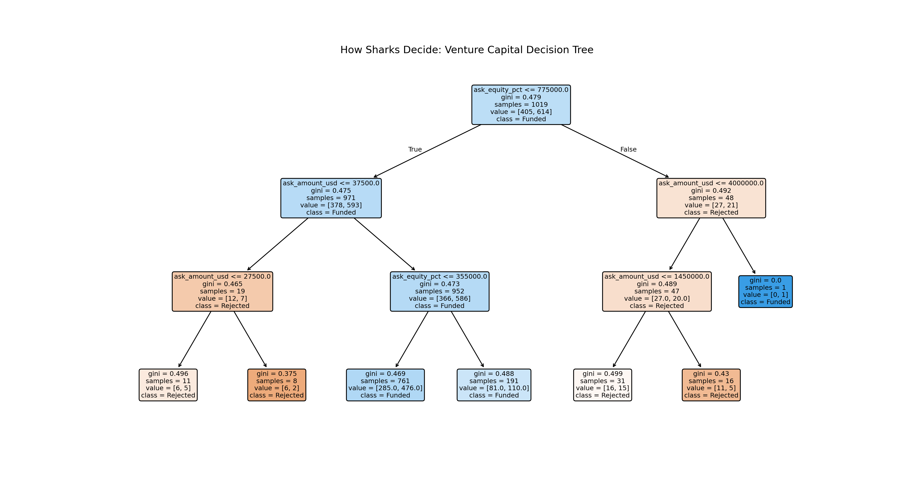

# 🦈 Shark Tank Decoder: VC Investment Analytics & Machine Learning

An end-to-end data engineering, machine learning, and visual analytics project decoding investment decisions across 1,274 pitches on *Shark Tank (US)*.

---

## 📌 Executive Summary
- **Dataset Size:** 1,274 Pitches across 14 Seasons
- **Overall Deal Rate:** 60.05% (765 Deals Closed)
- **Average Funding Request:** $284,137.36 for 17.2% Equity
- **ML Predictor Accuracy:** 60.39% (Decision Tree Classifier)

---

## 🛠️ Project Structure & Architecture

---

## 🤖 Machine Learning Decision Tree Model
i trained a Scikit-Learn Decision Tree Classifier to analyze how ask size, equity percentage, and demographics drive funding outcomes.

---

## 📊 Interactive Tableau Dashboard
View the live executive dashboard tracking Shark deal volumes and industry valuations:
👉 **[View Interactive Tableau Dashboard](https://prod-ch-a.online.tableau.com/t/mosestv2244-638548aa76/authoring/SharkTankDecoderVCAnalytics/Dashboard1#1)**

---

## 💻 How to Run
1. Run data pipeline: `python python/clean_data.py`
2. Train ML model: `python python/decision_tree_model.py`